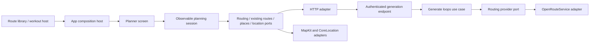

# Distance-targeted loop planning

Open when changing loop generation, its provider, or the full-screen iOS planner.

## Boundaries

- `backend/src/routePlanning` owns provider-neutral request/candidate types, generation, geometry validation, overlap ranking, and the OpenRouteService HTTP adapter. No database rows or provider DTOs escape this boundary.
- `POST /v1/routes/generate` authenticates and validates bounded input; the existing backend hosts it initially. Extraction changes composition and transport, not the planning contract.
- iOS `Routes/Planning` owns domain models, the repository port/HTTP adapter, one observable session, and a pluggable full-screen host returning a prepared route or cancellation. It does not own workouts.
- Generated routes are private device-local canonical snapshots, with provider attribution retained through direction changes and session recovery. They never create public community routes or enter bookmark/completion APIs.

## Generation contract

- Start coordinate, typed activity, explicit metric target, optional selected via coordinate; default acceptance is ±10%. Never widen silently.
- Running, walking and hiking use the supported ORS foot profiles. Unsupported activity types return an explicit unavailable response; cycling is domain-ready but not exposed until verified.
- Without a via, bounded seeded ORS round trips provide alternatives. An out-of-range result can use one distance-corrected proposal with the same seed before moving to another seed; only the provider proposal changes, never the target or ±10% acceptance. With a via, bounded closed waypoint routes include that point. The provider allocates opposite-side outbound/return shaping points around the start–via baseline and derives their width from a proposed perimeter; each of three shape variants gets at most one immediate distance-corrected retry. Seeded bounded skew varies subsequent searches. A via within 50 m of the start uses the normal round-trip proposal to avoid degenerate spokes; the same canonical start/via validation remains authoritative. Every result must close, remain near the requested start/via, contain valid canonical geometry, and fall within the target range.
- Stop as soon as three validated, diverse candidates are available. Preserve validated partial results if a later provider call fails, reaches quota, or exhausts the time budget.
- Rank limited backtracking and geometric diversity ahead of exact target matching. At most three candidates; fewer or none is valid. Geometry overlap uses quantized undirected segments because edge IDs are unavailable.
- No scenic, quiet or stop-count promises without verified provider evidence. Less climbing ranks returned measured elevation gain, with unknown values last. Place search remains MapKit-owned on iOS; selecting a place is explicit and does not imply its centroid is an entrance.

## Operations and privacy

- Set server-only `ORS_API_KEY`; optionally `ORS_API_BASE_URL` for a compatible hosted/self-hosted deployment. Default: `https://api.heigit.org/openrouteservice`. Do not put keys in either mobile app.
- Missing credentials returns 503 `route_planning_unavailable`; no synthetic fallback. Request budgets: 6 provider calls, 25 seconds overall, 8 seconds per call, three generation requests/minute/identity per backend instance.
- Empty 200 responses mean no suitable route was found in the bounded search; provider failures with no accepted candidate return 503 `route_planning_unavailable`. Auth/quota/configuration failures stop provider calls immediately. ORS routing codes 2009 (no route) and 2010 (no routable point) on 400/404 are legitimate no-route results; an unrecognized 404 is a configuration failure. See the [official ORS error codes](https://giscience.github.io/openrouteservice/api-reference/error-codes).
- Safe server operational diagnostics record bounded outcome (`success`, `partial`, `no_match`, `unavailable`, `cancelled`), accepted/call/failure/rejection counts, elapsed milliseconds, and failure category/status. These are service reliability instrumentation; never include coordinates, queries, route IDs, landmark names, target distances, response bodies or credentials.
- Caller cancellation ends quietly with an empty 499 response and a `cancelled` info outcome; it does not count as a provider failure. The generator owns the separate 25-second deadline, and service/per-call timeouts remain failures.
- Focused offline verification: `cd backend && npm run build && node scripts/check-route-generation.mjs`. This uses fake providers and HTTP responses; no credentials, live provider calls, database, or full test suite.
- No schema change or data migration is needed.
- Bounded manual ORS comparison (2026-11-26): three fixed-seed public-area start/via cases, six calls per version/case, 36 total calls. Old/new accepted counts were 0/1 (near waypoint, 5 km), 2/3 (moderate waypoint, 5 km), and 0/1 (farther waypoint, 10 km); successful requests improved from 1/3 to 3/3. All accepted geometry passed unchanged ±10%, closure, start/via, backtracking and diversity gates; no provider failures occurred. This single-area sample does not guarantee routes for every waypoint or road network.

### Provider configuration

- Local `npm run start:local` loads `~/.config/plainstride/ors.env` before repository env files, using the same loader as `ably.env`. Store server-only `ORS_API_KEY` there and restrict the file to its owner (`chmod 600 ~/.config/plainstride/ors.env`). An explicitly supplied process environment value takes precedence. Keep the tracked `backend/.env.example` key blank.
- Production uses Secret Manager secret `outbound-ors-api-key` in project `outbound-494602`; grant the Cloud Run runtime identity secret accessor permission. Never pass the raw key to the deploy helper or store it in Git. Set `ORS_API_KEY_SECRET=outbound-ors-api-key` to bind `ORS_API_KEY` to that secret's latest version during an authorized deployment.
- The helper uses `--update-secrets`, preserving existing bindings when `ORS_API_KEY_SECRET` is omitted. `ORS_API_BASE_URL` is an optional nonempty deploy override; omitting it preserves any existing Cloud Run value. Without an environment override, the adapter uses `https://api.heigit.org/openrouteservice`.
- This configuration requires no database, schema, seed, or cache reset. Provider availability and generated geometry require a separate live check; configuring a key or compiling the backend alone does not establish routing behavior.

## Interaction and verification

- Today → overflow → Find a route opens the comparison map directly. The comparison screen has no Saved routes toolbar button; matching saved/community suggestions remain in comparison and the existing route library remains available from its other entry points. The saved/import picker does not expose another planner. Each saved-route opening starts from the attached route; Close/swipe cancels and discards unapplied choices/preparation, while a document picker covering it preserves the draft. Standalone discovery uses the same Find a route entry.
- A fresh accepted GPS fix generates once, using the current workout's explicit distance when present (including manual goals), otherwise 5 km / 3 mi. Canonical workout meters stay exact across rounded metric/imperial display and an unchanged Done action; only an edited distance replaces them. The map stays uncovered. Changing start never resets the chosen target; the ±10% acceptance bound is unchanged. Successful generated suggestions are privately cached per account on device for seven days, bounded to 30 individual routes across planner openings. Automatic GPS, address and map confirmations can reuse matching activity/preferences/required-place intent only when the actual routed first point, snapped start and closing point are within 50 m of the new start and canonical distance meets the current target’s ±10% interval. Geometry and attribution remain unchanged; explicit required places are never approximated. Eligible cached routes appear immediately while saved/community lookup continues. Automatic requests generate additional choices only when fewer than three diverse matches remain; explicit More routes always makes a provider attempt. Failed refreshes retain valid matching cached routes with temporary fallback feedback. Closing clears only presentation memory; logout purges the departing account’s disk cache and account epochs reject late reads/writes. See [iOS route suggestion cache](route-suggestion-cache.md) for storage, validation and verification. HTTP 429 gives a wait-one-minute/saved-route action without logging request contents.
- The normal comparison map exposes a compact Move start action. In map placement, pan beneath a fixed center pin (or tap to recenter), then Confirm start once; no camera frame starts a request. Cancel preserves the committed start and usable suggestions without regenerating. Start/place and distance controls are disabled during the draft. New start/waypoint intent frames both requested points immediately; settled results frame all current route geometry plus both points, including empty/failure states. Refreshes preserve the viewport while loading, then frame replaced geometry once when settled. A pending fit waits until map placement closes.
- Distance opens a local preset/custom draft; Cancel leads the top toolbar and Done trails it, committing and refreshing. Route options use the same toolbar; there is no bottom Done action. The start field debounces MapKit place lookup by 300 ms while typing and displays a dropdown beneath the controls. Each changed query clears old rows immediately; stale/cancelled completions cannot publish. Typing never generates routes. Selecting a result dismisses the keyboard and generates from that place. Keyboard Search opens a focused results-only sheet with My location, Choose on map and Close; it has no duplicate search field. The optional waypoint editor retains its own semantic search field with an inline search icon and clear action. Nested planner sheets explicitly inherit the planner’s resolved app appearance and selected palette. Current-location/map choices cancel pending searches. Place lookup state diagnostics and analytics exclude queries, names and coordinates.
- Route options and the Waypoint search show the single current waypoint by its original MapKit name, with a compact adjacent × removal action (44 pt target). Add waypoint becomes Change waypoint when one is selected; selecting another replaces it. A waypoint is a place the route passes through, not a planned stop. The picker applies a result immediately on tap and has an explicit top Close action; options’ climbing draft survives opening the picker. The session owns that name and required coordinate together. Removing it immediately invalidates prior results and refreshes with no required place, retaining the start, distance and climbing preference. This does not change a workout or committed route attachment. The waypoint map annotation stays at the requested coordinate; tapping its 44 pt marker reveals the original name in a native anchored popover, without also selecting a nearby route. The popover stays within native presentation bounds, wraps the name, and scrolls at large text sizes without moving the map camera. Changing/removing the waypoint hides its old name callout. The marker yields to explicit map-start placement.
- `ActivityLaunchPreferenceStore` owns the committed selected route in one current-account file (`Application Support/SelectedRoute-v1/<hashed owner>.json`), with atomic protected writes, backup exclusion and no anonymous fallback (route use requires a signed-in account). There is no per-instance selection cache. Explicit route use, library selection, removal and direction changes write this same source; browsing/closing does not. Logout or account switch deletes the departing account selection. No migration or reset command is required.
- Reopening the planner prefers an explicit host workout attachment, otherwise the committed shared selection. This reconciliation only chooses the preview; it does not rewrite a host workout or commit a new selection. The restored canonical route appears as the highlighted sole candidate immediately, with original geometry, direction and provenance, including offline or without GPS. It does not trigger location lookup or generation until the user explicitly changes inputs or requests More routes. The current workout's exact goal remains independent of the route's distance. Route-free workout snapshots and existing attachment identity/prescription remain owned by the workout host.

- Keep the current map framing and previous geometry while a replacement loads. Previous results are stale and cannot be selected on the map or used; only candidates validated for the current input revision become selectable. One plain route summary pages horizontally; a centered count and accessible previous/next controls sit at the top of the panel. Larger semantic typography gives distance and climbing equal prominence in one row, using decorative distance/climbing icons and localized accessibility labels/values. Equal-width metric columns allow values to wrap within their own column; the metrics never switch to separate rows or shrink the text. No source-status text appears in comparison. Browsing highlights that route in an opaque 7 pt blue/cyan stroke, drawn above 2 pt purple alternatives at 85% opacity without moving the comparison camera or committing selection. Rounded strokes use contrast casing (10 pt selected / 5 pt alternatives, white in light appearance and black in dark); selected routes use deep blue (#005FCC) in light appearance and bright cyan (#53CFFF) in dark, while alternatives use deep purple (#7B3FB2) and lavender (#C5A3FF) respectively, and fully opaque numbered marker rings match each route’s hue. Tapping a numbered marker or route highlights it and updates the existing comparison panel without opening another sheet. The panel retains the route name, distance/elevation row, conditional start offset and Use route. Use route attaches the highlighted current route through the guarded persistence path; browsing alone never attaches it. Provider attribution text is omitted from these summaries; canonical attribution remains retained, and native map attribution remains visible. More routes requests alternatives; Try again retries an empty/error response. Settled empty/error results center the confirmed start, and Move start centers it explicitly; route loading itself keeps the camera steady. No-route, location-unavailable and generation-failure states offer a visible next action; no state automatically opens an editor.
- Generated comparison names use the current map position (Loop 1, Loop 2, Loop 3), including saved suggestions from earlier batches; generated routes have no user rename feature. These presentation labels can change between comparisons. An authored imported/community name remains intact; a generated label colliding with it adds the first unused localized numeric suffix, without changing authored names. Legitimate authored duplicates remain distinguishable by numbered map markers, page position and route metrics. Existing route-ID/corridor deduplication removes matching geometry independently of names. Only explicit Use route persists the current generated label; reopening the sole committed selection retains its original canonical name, direction and metadata.
- Canonical source/provenance and personal-match ranking remain unchanged even though source labels are hidden. The comparison pager measures each page's natural content height at its current width/text size, caps it at 28% of the viewport, and scrolls overflow; the action row follows without a fixed empty summary area.
- Route generation/location progress appears in a non-intercepting overlay over the map, outside the bottom panel's layout. Existing summary and action positions stay stable during refresh; More routes retains its label while loading with existing candidates. Current valid cached choices remain usable; stale choices retain the existing selection guard. Place-search progress remains within its dropdown/results list.
- Committed input changes cancel/invalidate candidate selection; editor drafts leave the current request untouched. Dismissal cancels work and stale completions cannot select a route. Persist canonical geometry before returning selection. Generated attachment preserves the workout sport, identity, prescription, cues and goal.
- iOS route replacement and removal restore the latest committed workout goal, including goal edits and race plans applied while a route is attached. The route-free snapshot keeps the authored workout metadata and calorie estimates current; route distance remains separate from the exact goal. Target-mode cards require an actual target, so a freestyle intent never displays a freestyle goal card.
- iOS retains one `LoopPlanningPresentation` per opening above transient SwiftUI content. It owns the observable session and one mutually exclusive input or saved-routes sheet. The route-library composition adapter retains the opening and supplies its dependencies; domain/session types do not depend on the community picker.
- `StableSheetPresenter` owns the full-screen hosting root. Focused sheets open only from their explicit controls; they remain stable while location, routes and parks load. Parent/store/theme publications do not replace that root or restart GPS. A child `onDisappear` is not cancellation. Explicit Back, actual dismissal and account-boundary changes cancel the session and reject stale callbacks; account observation survives removal of the original scene content until dismissal finishes.
- Candidate geometry changes fit the comparison camera to the actual route bounds. Summaries and polyline rendering still require visual verification; candidate existence alone does not establish a visible route.
- Initial implementation checks covered backend TypeScript build, iOS device compile, design-system checker and scoped diff. Provider activation has separate bounded live evidence below. Map interactions, VoiceOver, large text and language/theme rendering still require device verification; no test suite or simulator execution ran.

## Dependency and ownership map

| Owner | Responsibility |
| --- | --- |
| Domain | Coordinates, typed activity/source, requests/candidates, shared-source ranking; no MapKit, database record or workout types |
| Application session | Input revision, active-account/presentation checks, cancellation, observable candidate/search state |
| Infrastructure | API DTO mapping, community geometry lookup, MapKit place search, fresh accurate GPS |
| Presentation | One opening's session and mutually exclusive input or saved-routes sheet; caller retains it across view updates |
| Screen | Map, numbered cards, focused local editor drafts, optional start-pin adjustment and reactive session rendering |
| App host | Dependency injection, localization of generated route names, durable canonical selection and callback |
| Workout host | Compatible attachment preserving original workout identity, sport, prescription, cues, title and goals |

## Current capabilities and limits

- The route library offers **Find a route**. The workout route picker supplies its explicit target distance and activity; standalone discovery defaults to 5 km / 3 mi with balanced routing (Less climbing off). Metric/imperial presentation follows app preferences, transport stays metric.
- Parks are real MapKit suggestions, selected explicitly as an optional via place. There is no unsupported Scenic toggle; viewpoints and fewer-stops routing remain future provider capabilities. Cycling is typed but unavailable until supported/verified.
- Less climbing ranks measured elevation gain, with unknown elevation behind known values. It compares the bounded returned alternatives; it does not claim the globally flattest route.
- Saved private snapshots and existing nearby community loops are validated against sport, geometry, loop closure, target tolerance and optional via. They remain available if ORS is unconfigured. Generated and existing candidates share comparison, diversity ranking and selection; community provenance remains intact.
- `variationSeed` is optional integer `0...1000000`, allowing a new set of bounded proposals. Via generation uses three initial headings then three radius corrections using actual routed lengths. A via farther than the maximum round-trip budget returns no candidate.
- Initial implementation had no provider credentials and established compile/static evidence only. Production ORS activation on November 23, bounded Bellevue 10 km live generation, and the successful repeat in the deployed Cloud Run image are recorded in [backend-deploy.md](backend-deploy.md#ors-route-provider-activation--2026-11-23). Two loops met the 9–11 km tolerance, closure/start checks passed, and less-climbing ordering matched measured ascent. Authenticated mobile API use, physical-device interaction/rendering and permission/entrance checks remain unverified.

## Android integration

- Android uses the same metric generation API and comparison contract. Search uses Android Geocoder plus explicit map selection; Android currently has no nearby POI provider. Nearby park suggestions are an iOS MapKit capability.
- Imported canonical geometry uses `routes.imported.v2`; changing to this namespace resets previous local imports without migration. Accepted planner routes use the separate account-scoped `route_planner.accepted` cache. No older Android route storage is read or copied.
- Recording launch preferences are scoped to the active account/session using `recording_launch_<account>`; selected geometry is persisted before planner dismissal.
- Community route caches retain canonical geometry and provenance with attachment policy cleared. The selected route returned to the workout host and active-session recovery snapshot retain that presentation's policy.

### iOS foreground location ownership

- `ForegroundLocationSource.shared` owns the app's latest in-memory physical fix and foreground one-shot requests. `MainTabView` injects it into the Today/app `LocationManager` facade; `CoreLocationLoopProvider` uses the same source and can be injected into a planner opening. Planner cache reuse requires current authorization, finite valid coordinates, nonnegative accuracy at most 100 m, age under 60 seconds and less than 5 seconds into the future. There is no persisted-location or stale/coarse fallback.
- A valid shared fix seeds the opening's start and initial map camera synchronously. The retained presentation starts route lookup/generation once through the existing session revision/cache path. Missing or expired fixes use the existing 15-second location lookup, permission prompt, unavailable feedback and manual-start actions. Choosing an address/map point still cancels only that planner's location intent.
- Each foreground requester has its own UUID, continuation, timeout and cancellation. Cancelling a planner or replacing a Today refresh cannot cancel another requester. Authorization loss clears the source and rejects pending requests; every cached read checks current authorization. Newer physical fixes advance the cache, including valid fixes contributed by the independent recording manager.
- `ActivityRecorder` retains its own default `LocationManager`, delivery, accuracy, preparation, pause/resume, background and indoor policies. The source never starts/stops recording or feeds fixes back into its recording filter. Indoor, simulated and restored track data do not populate the foreground source.
- Weather retains its reduced-accuracy request and weather-cache policy. Community-route discovery retains its discovery-owned location lifecycle, and Social event setup retains its own location manager. They are not converted to recording/precise planner policies by this change; consolidating those consumers requires preserving their separate acquisition and privacy contracts.
- Location-source analytics uses only `feature_exposed`, `feature=loop_planner_location`, `result=cached|fresh`. No coordinates, timestamps, exact accuracy, identifiers or per-fix analytics are emitted.

## Unified iOS comparison

- The composition adapter injects private saved routes through `CommunityRouteStore.plannerPersonalRoutes`; domain/session do not depend on the library. Canonical imported/generated/community provenance and attribution survive selection. Personal-match ranking is separate from canonical source and does not imply a visible Saved label.
- Private snapshots plus up to 12 owned/bookmarked summaries prefiltered by sport, loop shape and target distance (and at most 12 missing details), then at most six nearby details, enter sport/closed-loop/±10%/required-place validation. Their actual routed start must be within 2 km; its offset is shown rather than connected. Unknown-sport imports remain in Saved for explicit selection, excluded from automatic matching. Geometry stays whole and unchanged, with the selected direction applied.
- Less climbing ranks measured gain first, unknown last; within that preference saved matches precede community and generated suggestions. Route ID and corridor overlap deduplicate choices and favor variety. No publication or cache reset occurs.
- The start chip shows the chosen place name, My location, or Map location. Its sheet supports current location, explicit address/place search, and choosing on the map. Draft edits/cancellation retain existing request ownership.
- Build/static checks do not verify swipe interaction, map rendering, long translated labels, large text, VoiceOver or appearance. These remain device checks.
