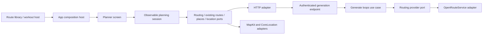

# Distance-targeted loop planning

Open when changing loop generation, its provider, or the full-screen iOS planner.

## Boundaries

- `backend/src/routePlanning` owns provider-neutral request/candidate types, generation, geometry validation, overlap ranking, and the OpenRouteService HTTP adapter. No database rows or provider DTOs escape this boundary.
- `POST /v1/routes/generate` authenticates and validates bounded input; the existing backend hosts it initially. Extraction changes composition and transport, not the planning contract.
- iOS `Routes/Planning` owns domain models, the repository port/HTTP adapter, one observable session, and a pluggable full-screen host returning a prepared route or cancellation. It does not own workouts.
- Generated routes are private device-local canonical snapshots, with provider attribution retained through direction changes and session recovery. They never create public community routes or enter bookmark/completion APIs.

## Generation contract

- Start coordinate, typed activity, explicit metric target, optional selected via coordinate; default acceptance is ±10%. Never widen silently.
- Running, walking and hiking use the supported ORS foot profiles. Unsupported activity types return an explicit unavailable response; cycling is domain-ready but not exposed until verified.
- Without a via, bounded seeded ORS round trips provide alternatives. With a via, bounded closed waypoint routes include that point. Every result must close, remain near the requested start/via, contain valid canonical geometry, and fall within the target range.
- Rank limited backtracking and geometric diversity ahead of exact target matching. At most three candidates; fewer or none is valid. Geometry overlap uses quantized undirected segments because edge IDs are unavailable.
- No scenic, quiet or stop-count promises without verified provider evidence. Less climbing ranks returned measured elevation gain, with unknown values last. Place search remains MapKit-owned on iOS; selecting a place is explicit and does not imply its centroid is an entrance.

## Operations and privacy

- Set server-only `ORS_API_KEY`; optionally `ORS_API_BASE_URL` for a compatible hosted/self-hosted deployment. Default: `https://api.heigit.org/openrouteservice`. Do not put keys in either mobile app.
- Missing credentials returns 503 `route_planning_unavailable`; no synthetic fallback. Request budgets: 6 provider calls, 25 seconds overall, 8 seconds per call, three generation requests/minute/identity per backend instance.
- Safe diagnostics contain operation/status/category only, never coordinates, queries, route IDs, landmark names, response bodies or credentials.
- No schema change or data migration is needed.

### Provider configuration

- Local `npm run start:local` loads `~/.config/plainstride/ors.env` before repository env files, using the same loader as `ably.env`. Store server-only `ORS_API_KEY` there and restrict the file to its owner (`chmod 600 ~/.config/plainstride/ors.env`). An explicitly supplied process environment value takes precedence. Keep the tracked `backend/.env.example` key blank.
- Production uses Secret Manager secret `outbound-ors-api-key` in project `outbound-494602`; grant the Cloud Run runtime identity secret accessor permission. Never pass the raw key to the deploy helper or store it in Git. Set `ORS_API_KEY_SECRET=outbound-ors-api-key` to bind `ORS_API_KEY` to that secret's latest version during an authorized deployment.
- The helper uses `--update-secrets`, preserving existing bindings when `ORS_API_KEY_SECRET` is omitted. `ORS_API_BASE_URL` is an optional nonempty deploy override; omitting it preserves any existing Cloud Run value. Without an environment override, the adapter uses `https://api.heigit.org/openrouteservice`.
- This configuration requires no database, schema, seed, or cache reset. Provider availability and generated geometry require a separate live check; configuring a key or compiling the backend alone does not establish routing behavior.

## Interaction and verification

- Find a loop opens from the existing route library. Start fresh at GPS, search for a start, or move the start pin. Optional via search is separate. A numeric target is explicit; comparison retains all numbered colored alternatives while details close independently.
- Input changes cancel/invalidate candidates. Dismissal cancels work and stale completions cannot select a route. Persist canonical geometry before returning selection. Generated attachment preserves the workout sport, identity, prescription, cues and goal.
- iOS retains one `LoopPlanningPresentation` per opening above transient SwiftUI content. It owns the observable session and one mutually exclusive input/details sheet. The route-library composition adapter retains the opening and supplies its dependencies; domain/session types do not depend on the community picker.
- `StableSheetPresenter` owns the full-screen hosting root. The initial input sheet opens only after UIKit's outer presentation completes. Parent/store/theme publications do not replace that root or restart GPS. A child `onDisappear` is not cancellation. Explicit Back, actual dismissal and account-boundary changes cancel the session and reject stale callbacks; account observation survives removal of the original scene content until dismissal finishes.
- Candidate geometry changes fit the comparison camera to the actual route bounds. Cards and polyline rendering still require visual verification; candidate existence alone does not establish a visible route.
- Initial implementation checks covered backend TypeScript build, iOS device compile, design-system checker and scoped diff. Provider activation has separate bounded live evidence below. Map interactions, VoiceOver, large text and language/theme rendering still require device verification; no test suite or simulator execution ran.

## Dependency and ownership map

| Owner | Responsibility |
| --- | --- |
| Domain | Coordinates, typed activity/source, requests/candidates, shared-source ranking; no MapKit, database record or workout types |
| Application session | Input revision, active-account/presentation checks, cancellation, observable candidate/search state |
| Infrastructure | API DTO mapping, community geometry lookup, MapKit place search, fresh accurate GPS |
| Presentation | One opening's session and mutually exclusive input/detail sheet; caller retains it across view updates |
| Screen | Map, numbered cards, explicit place access-point confirmation and reactive session rendering |
| App host | Dependency injection, localization of generated route names, durable canonical selection and callback |
| Workout host | Compatible attachment preserving original workout identity, sport, prescription, cues, title and goals |

## Current capabilities and limits

- The route library offers **Find a loop**. The workout route picker supplies its explicit target distance and activity; standalone discovery begins without a target. Metric/imperial presentation follows app preferences, transport stays metric.
- Parks are real MapKit suggestions and pins, selected explicitly as a required via access point. There is no unsupported Scenic toggle; viewpoints and fewer-stops routing remain future provider capabilities. Cycling is typed but unavailable until supported/verified.
- Less climbing ranks measured elevation gain, with unknown elevation behind known values. It compares the bounded returned alternatives; it does not claim the globally flattest route.
- Existing nearby community loops are validated against sport, geometry, loop closure, target tolerance and optional via. They remain available if ORS is unconfigured. Generated and existing candidates share comparison, diversity ranking and selection; community provenance remains intact.
- `variationSeed` is optional integer `0...1000000`, allowing a new set of bounded proposals. Via generation uses three initial headings then three radius corrections using actual routed lengths. A via farther than the maximum round-trip budget returns no candidate.
- Initial implementation had no provider credentials and established compile/static evidence only. Production ORS activation on November 23, bounded Bellevue 10 km live generation, and the successful repeat in the deployed Cloud Run image are recorded in [backend-deploy.md](backend-deploy.md#ors-route-provider-activation--2026-11-23). Two loops met the 9–11 km tolerance, closure/start checks passed, and less-climbing ordering matched measured ascent. Authenticated mobile API use, physical-device interaction/rendering and permission/entrance checks remain unverified.

## Android integration

- Android uses the same metric generation API and comparison contract. Search uses Android Geocoder plus explicit map selection; Android currently has no nearby POI provider. Nearby park suggestions are an iOS MapKit capability.
- Imported canonical geometry uses `routes.imported.v2`; changing to this namespace resets previous local imports without migration. Accepted planner routes use the separate account-scoped `route_planner.accepted` cache. No older Android route storage is read or copied.
- Recording launch preferences are scoped to the active account/session using `recording_launch_<account>`; selected geometry is persisted before planner dismissal.
- Community route caches retain canonical geometry and provenance with attachment policy cleared. The selected route returned to the workout host and active-session recovery snapshot retain that presentation's policy.
